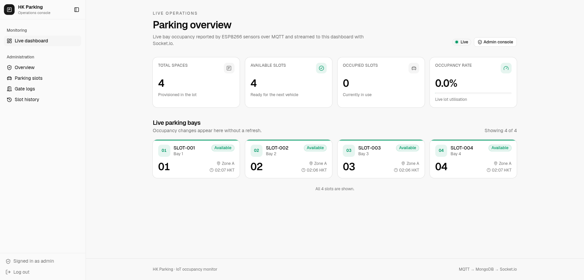

# HK Parking

A real-time, IoT-integrated smart parking dashboard. Four ESP32 parking bays
publish their occupancy over MQTT; gate sensors publish entry and exit events.
A custom Node server persists every change in MongoDB and pushes it to every
open browser over Socket.io — no refresh, no polling.

The project ships with an authenticated operations console for viewing live
occupancy, gate activity, and slot usage history.

---

## Table of contents

- [What the project does](#what-the-project-does)
- [How it works](#how-it-works)
- [Features](#features)
- [Tech stack](#tech-stack)
- [Hardware](#hardware)
- [MQTT contract](#mqtt-contract)
- [REST API](#rest-api)
- [Socket.io events](#socketio-events)
- [Data model](#data-model)
- [Project structure](#project-structure)
- [Getting started](#getting-started)
- [Environment variables](#environment-variables)
- [Scripts](#scripts)
- [Troubleshooting](#troubleshooting)
- [Security notes](#security-notes)
- [License](#license)
- [Live dashboard](#live-dashboard)

---

## What the project does

The parking lot is modelled as a set of bays (`SLOT-001`, `SLOT-002`, …). Each
bay has an infrared sensor that reports whether a vehicle is present. Two
additional sensors detect vehicles at the entry and exit gates, which drive
servo motors and produce gate events.

The system turns that physical state into a live web experience:

- Occupied and available bay counts, plus an occupancy percentage, update in
  real time.
- Every occupancy change is written to an audit trail with a timestamp and,
  where possible, the duration of the previous occupancy cycle.
- Gate openings, closures, and unauthorized attempts are recorded with their
  trigger source (`MQTT_SENSOR`, `RFID`, or `ADMIN_OVERRIDE`).
- Administrators can inspect the overview, parking slots, gate logs, and slot
  history behind a cookie-based login.

The repository is intentionally **hardware-first**: there is no demo dataset.
`pnpm seed` provisions only the four hardware-linked bays
(`SLOT-001` … `SLOT-004`) and leaves all activity and gate history empty until
real MQTT messages arrive.

## How it works

### End-to-end flow

```text
┌────────────────────┐
│ ESP32 parking unit │
│ 4 bay IR sensors   │
│ entry/exit sensors │
│ LCD, servos, LEDs  │
└─────────┬──────────┘
          │ MQTT publish (QoS 0)
          ▼
┌────────────────────┐
│ Mosquitto broker   │
│ :1883              │
└─────────┬──────────┘
          │ subscriptions
          ▼
┌─────────────────────────────────────────────────────────────┐
│ server.ts — custom Node HTTP server                        │
│                                                             │
│  1. Next.js request handler (App Router)                   │
│  2. Socket.io server at /api/socket_io                     │
│  3. MQTT listener (parking/slots/#, parking/gates/#,        │
│     plus legacy firmware topics)                           │
│  4. POST /internal/broadcast bridge for REST writes        │
└───────┬───────────────────────────────┬─────────────────────┘
        │ Mongoose                      │ io.emit(...)
        ▼                               ▼
┌────────────────────┐          ┌────────────────────┐
│ MongoDB            │          │ Browser            │
│ parking_slots      │          │ React dashboard    │
│ slot_activity_logs │          │ Socket.io client   │
│ gate_logs          │          │ live updates       │
└────────────────────┘          └────────────────────┘
```

### The two write paths

There are two ways data can enter the system, and both converge on the same
domain functions in `src/lib/parking.ts`:

1. **MQTT path** — `src/lib/mqtt.ts` receives a message, normalizes the topic
   and payload, then calls `applySlotState()` or `recordGateEvent()`. Because
   the MQTT listener runs inside the custom server, it emits Socket.io events
   directly.
2. **REST path** — Next.js route handlers (for example `POST /api/slots`) call
   the same domain functions. Route handlers run in a different module context
   from the custom server, so they publish to the browser through
   `POST /internal/broadcast`. The custom server validates a shared secret and
   re-emits the event over Socket.io.

This shared-domain design keeps audit logs, statistics, and realtime payloads
consistent no matter where a change originated.

### Slot state transitions

For every slot message, the server:

1. Parses the topic to find the slot ID.
2. Parses the payload into a boolean (`true`/`false`, JSON object, or accepted
   string values).
3. Calls `applySlotState()`, which performs an atomic `findOneAndUpdate`
   filtered on `isOccupied: { $ne: occupied }`.
4. If nothing changed, stops. This deduplicates chatty sensors.
5. If the state changed, updates `lastStateChangedAt`, writes a
   `SlotActivityLog`, and calculates the previous occupancy duration.
6. Returns the updated slot, current stats, and the new activity row.
7. Emits `slotUpdate` and `activityLogUpdate` to connected browsers.

If a slot does not exist and the message came from MQTT, it is auto-provisioned
using the trailing number in `SLOT-###` (or the next free bay number). The REST
API deliberately does not auto-create slots.

### Gate event flow

Gate messages are simpler: the server normalizes `OPENED`, `CLOSED`, or
`UNAUTHORIZED_ATTEMPT`, records a `GateLog` row with its trigger source, and
emits `gateLogUpdate`. Gate messages represent events, not state, so they should
**not** be published with the MQTT retain flag; otherwise a reconnecting
subscriber can replay an old event and create a duplicate log entry.

### Realtime delivery

The browser connects to Socket.io on `/api/socket_io`. The dashboard merges
incoming events into its local state:

- `slotUpdate` replaces the matching slot and refreshes the stat cards.
- `activityLogUpdate` prepends a row to the slot history.
- `gateLogUpdate` prepends a row to the gate activity table.

Newly auto-provisioned slots that are outside the currently loaded page are not
injected into the grid, but the statistics still account for them.

### Authentication and protected pages

- `/admin/login` posts credentials to `/api/login`.
- On success the API sets an HTTP-only `hk_admin_session` cookie valid for
  seven days.
- `src/proxy.ts` (Next.js 16's request proxy) protects `/admin/:path*` and
  redirects unauthenticated visitors to the login page with a `redirect` query
  parameter.
- Read endpoints for slots and gates are public; mutations and the activity
  endpoint verify the admin session themselves.
- `/api/logout` clears the cookie, and the admin navigation is hidden on the
  public dashboard until the session is active.

### Rendering model

The app uses Next.js 16 Cache Components. The dashboard is streamed inside a
`<Suspense>` boundary: `connection()` marks the live section as request-bound,
then the server reads slots, gate logs, and activity from MongoDB and renders
the initial HTML. Socket.io takes over from there. Route segment options such as
`dynamic` and `runtime` are intentionally absent because they are incompatible
with `cacheComponents`.

## Features

- **Live overview** — total bays, available bays, occupied bays, and occupancy
  rate, recalculated on every event.
- **Live bay grid** — slot ID, bay number, zone, status badge, and last state
  change time. The grid loads six bays at a time and supports "load more".
- **Realtime updates** — Socket.io pushes state changes without a page reload.
- **Gate monitoring** — `OPENED`, `CLOSED`, and `UNAUTHORIZED_ATTEMPT` events
  with RFID, sensor, or admin-override triggers.
- **Slot usage history** — occupied/vacated cycles with duration tracking.
- **Admin console** — protected overview, slot management, gate log, and slot
  history pages.
- **Collapsible sidebar** — desktop rail and mobile sheet; admin links only
  appear for signed-in administrators.
- **MQTT auto-provisioning** — new `SLOT-###` IDs can join without a manual
  seed; duplicate states are ignored.
- **Legacy firmware support** — the original ESP32 sketch's topics are mapped
  onto the current schema, so existing hardware keeps working.
- **Graceful failure** — a MongoDB outage renders an actionable error state
  instead of crashing the page.
- **Connection caching** — one Mongoose connection is reused across route
  handlers, scripts, hot reloads, and the custom server.

## Tech stack

| Layer | Choice |
| --- | --- |
| Framework | Next.js 16 (App Router, React Compiler, Cache Components) |
| UI | React 19, Tailwind CSS v4, shadcn/ui, Lucide icons |
| Language | TypeScript 5 |
| Database | MongoDB with Mongoose 9 |
| Realtime | Socket.io 4 (`socket.io` + `socket.io-client`) |
| IoT | MQTT 5 (`mqtt`), Mosquitto broker |
| Validation | Zod 4 |
| Tooling | pnpm, ESLint 9, `tsx` |

## Hardware

The reference build uses one ESP32 with:

| Function | GPIO | Notes |
| --- | --- | --- |
| Bay 1 IR sensor | 18 | `INPUT_PULLUP`, active LOW |
| Bay 2 IR sensor | 19 | `INPUT_PULLUP`, active LOW |
| Bay 3 IR sensor | 21 | `INPUT_PULLUP`, active LOW |
| Bay 4 IR sensor | 22 | `INPUT_PULLUP`, active LOW |
| Entry IR sensor | 23 | Controls the entry servo |
| Exit IR sensor | 25 | Controls the exit servo |
| Entry servo | 26 | 0° closed, 90° open |
| Exit servo | 27 | 0° closed, 90° open |
| Green LED | 32 | On while a bay is free |
| Red LED | 33 | On when all four bays are occupied |
| LCD SDA | 16 | I²C, address `0x27` |
| LCD SCL | 17 | I²C |

Both sketches close each gate three seconds after the vehicle leaves the
sensor. The LCD shows the state of all four bays.

### Firmware variants

| Sketch | Topics | Use |
| --- | --- | --- |
| `hardware/esp32_smart_parking/esp32_smart_parking.ino` | `parking/slot1` … `parking/slot4`, `parking/entry/gate`, `parking/exit/gate`, `parking/availability` | Original working firmware. The server adapts these legacy topics. |
| `hardware/esp32_smart_parking_dashboard/esp32_smart_parking_dashboard.ino` | `parking/slots/SLOT-001/state` … `parking/slots/SLOT-004/state`, `parking/gates/GATE-IN-01/event`, `parking/gates/GATE-OUT-01/event` | Dashboard-native contract. Slot state is retained; gate events are not. |

Both sketches keep Wi-Fi and broker credentials in `secrets.h`, which is
git-ignored. To compile either one:

```bash
cd hardware/esp32_smart_parking            # or esp32_smart_parking_dashboard
cp secrets.example.h secrets.h
# edit secrets.h with your Wi-Fi SSID/password and the broker's LAN IP
```

Then open the `.ino` file in Arduino IDE (ESP32 core 3.x, `PubSubClient`,
`LiquidCrystal_I2C`, `ESP32Servo`) and upload. Open the Serial Monitor at
`115200` baud to watch Wi-Fi, MQTT, and sensor messages.

> The broker machine and the ESP32 must be on the same network. `MQTT_SERVER`
> must be the broker machine's LAN IP, not `localhost`. The broker must also
> listen on an interface reachable from the ESP32 (for example
> `listener 1883 0.0.0.0`).

### Mapping hardware to bays

The four bay sensors map directly to the seeded slots:

| Sensor | Slot | Zone |
| --- | --- | --- |
| P1 | `SLOT-001` | Zone A |
| P2 | `SLOT-002` | Zone A |
| P3 | `SLOT-003` | Zone A |
| P4 | `SLOT-004` | Zone A |

`SLOT-005` and above are not present in the hardware-only dataset. Additional
slots can still be created automatically by publishing an MQTT message for a
new `SLOT-###` ID.

## MQTT contract

The server subscribes with QoS 0 to:

```text
parking/slots/#
parking/gates/#
parking/slot1
parking/slot2
parking/slot3
parking/slot4
parking/entry/gate
parking/exit/gate
```

Payloads may be JSON or plain strings. Topics are matched case-insensitively.

### Slots

Topic: `parking/slots/<SLOT_ID>/state` (the `/state` suffix is optional)

```json
{ "occupied": true }
```

Also accepted:

```text
true / false
1 / 0
"OCCUPIED" / "VACATED"
"AVAILABLE" / "FREE" / "EMPTY" / "BUSY"
"ON" / "OFF" / "TRUE" / "FALSE" / "1" / "0"
```

JSON objects may use `occupied`, `isOccupied`, `state`, `status`, or `value`.
Repeated states are ignored, so a noisy sensor does not create duplicate audit
rows. Publish slot state with `retain = true` so a restarted backend receives
the latest known state when it subscribes.

### Gates

Topic: `parking/gates/<GATE_ID>/event` (the `/event` suffix is optional)

```json
{ "event": "OPENED", "triggeredBy": "RFID" }
```

- `event`: `OPENED`, `CLOSED`, or `UNAUTHORIZED_ATTEMPT`. Aliases `OPEN`,
  `CLOSE`, and `UNAUTHORIZED` are normalized.
- `triggeredBy`: `MQTT_SENSOR`, `ADMIN_OVERRIDE`, or `RFID`. Defaults to
  `MQTT_SENSOR`.

Publish gate events with `retain = false`. A retained gate message is an event
that can be replayed as a duplicate after a reconnect.

### Legacy firmware topics

The original sketch still works:

| Legacy topic | Payload | Maps to |
| --- | --- | --- |
| `parking/slot1` … `parking/slot4` | `Occupied` / `Empty` | `SLOT-001` … `SLOT-004` |
| `parking/entry/gate` | `Open` / `Closed` | `GATE-IN-01` |
| `parking/exit/gate` | `Open` / `Closed` | `GATE-OUT-01` |
| `parking/availability` | JSON summary | Ignored (stats come from MongoDB) |

Retained legacy gate states are remembered silently on subscribe, and repeated
statuses are suppressed, so a backend restart does not create phantom gate log
entries.

### Try it by hand

```bash
# Occupy bay 2
mosquitto_pub -h 127.0.0.1 -t parking/slots/SLOT-002/state \
  -m '{"occupied":true}' -r

# Record an entry gate opening
mosquitto_pub -h 127.0.0.1 -t parking/gates/GATE-IN-01/event \
  -m '{"event":"OPENED","triggeredBy":"RFID"}'
```

## REST API

| Method | Endpoint | Auth | Description |
| --- | --- | --- | --- |
| `GET` | `/api/slots?page=1&limit=6` | Public | Paginated slots plus current stats |
| `POST` | `/api/slots` | Admin | Set an existing slot's occupancy |
| `GET` | `/api/gates?limit=20` | Public | Recent gate activity |
| `POST` | `/api/gates` | Admin | Record a gate event |
| `GET` | `/api/activity?limit=20&slotId=SLOT-002` | Admin | Slot usage history |
| `GET` | `/api/session` | Public | Whether the current cookie is authenticated |
| `POST` | `/api/login` | Public | Create an admin session |
| `POST` | `/api/logout` | Public | Clear the admin session |

`GET /api/slots` accepts `page >= 1` and `1 <= limit <= 48` (default 6).
`GET /api/gates` and `GET /api/activity` accept `1 <= limit <= 100`.
All GET responses send `Cache-Control: no-store`.

`POST /api/slots` accepts either form:

```json
{ "slotId": "SLOT-002", "isOccupied": true }
{ "slotId": "SLOT-002", "action": "VACATED" }
```

A successful state change writes a `SlotActivityLog`, recalculates stats, and
broadcasts `slotUpdate` + `activityLogUpdate`. Unknown slots return `404`.

`POST /api/gates`:

```json
{ "gateId": "GATE-IN-01", "event": "OPENED", "triggeredBy": "ADMIN_OVERRIDE" }
```

## Socket.io events

The client connects to path `/api/socket_io`.

| Event | Payload | UI effect |
| --- | --- | --- |
| `slotUpdate` | `{ slot: ParkingSlotDTO, stats: ParkingStats }` | Replace the bay card and refresh counters |
| `gateLogUpdate` | `GateLogDTO` | Prepend a row to gate activity |
| `activityLogUpdate` | `SlotActivityDTO` | Prepend a row to slot history |

DTO shapes live in `src/types/parking.ts`.

## Data model

### `ParkingSlot` → `parking_slots`

| Field | Type | Notes |
| --- | --- | --- |
| `slotId` | string | Unique, for example `SLOT-001` |
| `slotNumber` | number | Unique, used for ordering and display |
| `isOccupied` | boolean | Indexed |
| `lastStateChangedAt` | Date | Defaults to now |
| `zone` | string? | For example `Zone A` |

Compound index: `{ zone: 1, slotNumber: 1 }`.

### `SlotActivityLog` → `slot_activity_logs`

| Field | Type | Notes |
| --- | --- | --- |
| `slotId` | string | Slot that changed |
| `slotNumber` | number | Denormalized for sorting/display |
| `action` | `OCCUPIED` \| `VACATED` | Event type |
| `timestamp` | Date | Defaults to now |
| `durationMinutes` | number? | Filled on vacate when a previous occupancy exists |

Indexes: `{ slotId: 1, timestamp: -1 }` and `{ timestamp: -1 }`.

### `GateLog` → `gate_logs`

| Field | Type | Notes |
| --- | --- | --- |
| `gateId` | string | `GATE-IN-01` or `GATE-OUT-01` |
| `event` | `OPENED` \| `CLOSED` \| `UNAUTHORIZED_ATTEMPT` | Event type |
| `triggeredBy` | `MQTT_SENSOR` \| `ADMIN_OVERRIDE` \| `RFID` | Source |
| `timestamp` | Date | Defaults to now |

Indexes: `{ timestamp: -1 }` and `{ gateId: 1, timestamp: -1 }`.

Computed statistics (`total`, `occupied`, `available`, `occupancyRate`) are
derived from counts on every request and are never stored.

## Project structure

```text
hk-parking/
├── .env.example                  # documented environment template
├── .gitignore                    # ignores .env.local, secrets.h, build output
├── AGENTS.md                     # repository/agent conventions
├── .agents/                      # reusable agent skill references
├── skills-lock.json              # pinned skill versions
├── components.json               # shadcn/ui configuration
├── eslint.config.mjs             # ESLint 9 flat config
├── next.config.ts                # Cache Components, React Compiler, Turbopack
├── package.json                  # scripts and dependencies
├── pnpm-lock.yaml
├── pnpm-workspace.yaml
├── tsconfig.json
├── server.ts                     # custom Next.js + Socket.io + MQTT server
├── docs/
│   └── screenshots/
│       └── dashboard.png         # live dashboard screenshot
├── hardware/
│   ├── esp32_smart_parking/
│   │   ├── esp32_smart_parking.ino
│   │   └── secrets.example.h     # copy to secrets.h (git-ignored)
│   └── esp32_smart_parking_dashboard/
│       ├── esp32_smart_parking_dashboard.ino
│       └── secrets.example.h
├── public/                       # static assets
├── scripts/
│   ├── load-env.ts               # loads .env.local for tsx scripts
│   ├── mqtt-simulator.ts         # optional simulated sensor publisher
│   └── seed.ts                   # destructive reset to the four hardware bays
└── src/
    ├── app/
    │   ├── admin/
    │   │   ├── (protected)/
    │   │   │   ├── activity/page.tsx    # slot usage history
    │   │   │   ├── gates/page.tsx       # gate logs
    │   │   │   ├── layout.tsx           # protected admin shell
    │   │   │   ├── page.tsx             # admin overview
    │   │   │   └── slots/page.tsx       # parking slots
    │   │   └── login/page.tsx           # admin sign-in
    │   ├── api/
    │   │   ├── activity/route.ts        # admin slot history
    │   │   ├── gates/route.ts           # public read, admin write
    │   │   ├── login/route.ts           # session creation
    │   │   ├── logout/route.ts          # session removal
    │   │   ├── session/route.ts         # session probe
    │   │   └── slots/route.ts           # public read, admin write
    │   ├── dashboard/
    │   │   ├── layout.tsx               # sidebar shell
    │   │   └── page.tsx                 # Suspense-streamed dashboard
    │   ├── globals.css                  # Tailwind v4 theme
    │   ├── icon.svg
    │   ├── layout.tsx                   # root metadata and fonts
    │   └── page.tsx                     # redirects to /dashboard
    ├── components/
    │   ├── SlotCard.tsx                 # single bay card
    │   ├── app-shell.tsx                # sidebar + content shell
    │   ├── app-sidebar.tsx              # role-aware navigation
    │   ├── gate-activity-table.tsx
    │   ├── live-status.tsx              # socket connection badge
    │   ├── parking-dashboard.tsx        # client state + socket listeners
    │   ├── slot-history-table.tsx
    │   ├── stats-cards.tsx
    │   └── ui/                          # shadcn primitives
    ├── hooks/
    │   └── use-mobile.ts                # responsive sidebar helper
    ├── lib/
    │   ├── auth-server.ts               # request-scoped session check
    │   ├── auth.ts                      # cookie/token helpers
    │   ├── db.ts                        # cached Mongoose connection
    │   ├── format.ts                    # HKT date/time helpers
    │   ├── mqtt.ts                      # MQTT listener + topic adapters
    │   ├── parking.ts                   # queries, transitions, stats
    │   ├── realtime.ts                  # internal broadcast client
    │   └── utils.ts                     # class-name helpers
    ├── models/
    │   ├── GateLog.ts
    │   ├── ParkingSlot.ts
    │   └── SlotActivityLog.ts
    ├── proxy.ts                         # protects /admin/:path*
    └── types/
        └── parking.ts                   # DTOs and Socket.io contracts
```

## Getting started

### Prerequisites

- Node.js 20 or newer
- pnpm 9 or newer
- MongoDB (local, Docker, or Atlas)
- An MQTT broker such as Mosquitto
- Optional: ESP32 + Arduino IDE for the hardware side

### 1. Start MongoDB and Mosquitto

Docker:

```bash
docker run -d --name hk-parking-mongo -p 27017:27017 mongo:7
docker run -d --name hk-parking-mqtt -p 1883:1883 eclipse-mosquitto:2 \
  mosquitto -c /mosquitto-no-auth.conf
```

Local Mosquitto config:

```conf
listener 1883 0.0.0.0
allow_anonymous true
persistence false
```

### 2. Install and configure

```bash
pnpm install
cp .env.example .env.local
```

Edit `.env.local`:

- Set `MONGODB_URI` if MongoDB requires authentication or is remote.
- Set `MQTT_URL` to your broker.
- Change `ADMIN_USERNAME` and `ADMIN_PASSWORD` from the defaults.
- Change `INTERNAL_BROADCAST_SECRET` outside local development.

### 3. Reset to hardware-only data

```bash
pnpm seed
```

This is destructive: it clears `parking_slots`, `slot_activity_logs`, and
`gate_logs`, then inserts only `SLOT-001` … `SLOT-004` in the available state.
No demo activity or gate logs are created.

Restart `pnpm dev` after resetting so the MQTT listener re-subscribes and
reapplies the ESP32's retained slot and gate state.

### 4. Run the app

```bash
pnpm dev
```

The custom server starts Next.js, Socket.io, and the MQTT listener:

- Dashboard: <http://localhost:3000/dashboard>
- Admin login: <http://localhost:3000/admin/login>
- Default local credentials: `admin` / `admin123`

For UI-only work you can run `pnpm dev:next`, but live updates require the
custom server.

### 5. Connect the hardware

1. Copy the example secrets file and fill in your credentials.
2. Set `MQTT_SERVER` to the LAN IP of the machine running Mosquitto.
3. Upload the sketch from Arduino IDE.
4. Watch the dashboard update as the sensors change.

### Production

```bash
pnpm build
pnpm start
```

Run the app behind TLS, restrict `SOCKET_CORS_ORIGIN`, use broker
authentication, and set strong admin credentials and a unique internal
broadcast secret.

## Environment variables

| Variable | Default | Purpose |
| --- | --- | --- |
| `MONGODB_URI` | `mongodb://127.0.0.1:27017/hk_parking` | Mongoose connection string |
| `MQTT_URL` | `mqtt://127.0.0.1:1883` | Broker used by the server listener |
| `MQTT_USERNAME` / `MQTT_PASSWORD` | empty | Optional broker credentials |
| `MQTT_CLIENT_ID` | random | Optional stable MQTT client ID |
| `PORT` | `3000` | Next.js + Socket.io port |
| `INTERNAL_BROADCAST_SECRET` | dev fallback | Shared secret for the REST→Socket.io bridge |
| `SOCKET_CORS_ORIGIN` | same origin | Allowed Socket.io origin |
| `ADMIN_USERNAME` | `admin` | Admin console username |
| `ADMIN_PASSWORD` | `admin123` | Admin console password |

The custom server loads `.env.local` then `.env` before importing the
application, and `scripts/load-env.ts` does the same for CLI scripts.

## Scripts

| Script | Description |
| --- | --- |
| `pnpm dev` | Next.js + Socket.io + MQTT listener (`tsx watch server.ts`) |
| `pnpm dev:next` | Plain Next.js dev server without realtime/MQTT |
| `pnpm build` | Production build |
| `pnpm start` | Run the production build through the custom server |
| `pnpm lint` | ESLint |
| `pnpm typecheck` | `tsc --noEmit` |
| `pnpm seed` | Reset to the four hardware slots (no demo data) |
| `pnpm mqtt:sim` | Publish simulated sensor events (development only) |

> `pnpm mqtt:sim` adds simulated slots and events. Skip it when you want a
> hardware-only dashboard.

## Troubleshooting

### The dashboard shows no hardware updates

1. Confirm the ESP32 is connected to Wi-Fi and the broker.
2. Check the broker log for its client ID and published topics.
3. Confirm the broker listens on a LAN-reachable address, not only `127.0.0.1`.
4. Confirm `MQTT_URL` points at that broker and the server log shows the
   subscription list.
5. Use `mosquitto_sub -h <broker> -t 'parking/#' -v` to inspect live messages.
6. If the firmware publishes legacy topics (`parking/slot1`, etc.), make sure
   the server is running a version that includes the legacy adapter.

### Slot changes do not appear

- Use the exact `SLOT-###` identifier (`parking/slot1` is legacy-only).
- Check the payload is a recognized truthy/falsey value.
- Remember that repeated states are intentionally ignored.
- A retained state is delivered when the backend subscribes; restarting the
  server re-syncs the current hardware state.

### Gate events repeat after reconnecting

Retained gate messages are replayed by the broker. Publish gate events with
`retain = false` (the dashboard-native sketch already does), or rely on the
legacy adapter's duplicate suppression for the old firmware.

### MongoDB connection errors

- Verify `MONGODB_URI` and credentials.
- If the dashboard previously worked and the database is empty, run
  `pnpm seed` (and restart the server).
- Check the MongoDB container is running: `docker ps`.

### ESP32 cannot reach the broker

- `MQTT_SERVER` must be the broker machine's LAN IP.
- Both devices must be on the same network/VLAN.
- Allow TCP port 1883 through the host firewall.
- Some hotspots enable client isolation; disable it if the board cannot reach
  the laptop.

## Security notes

- `secrets.h` contains Wi-Fi and broker credentials and is git-ignored. Commit
  only `secrets.example.h`.
- `.env.local` is git-ignored. Never commit real database or admin passwords.
- Change `ADMIN_USERNAME`, `ADMIN_PASSWORD`, and
  `INTERNAL_BROADCAST_SECRET` before deploying.
- Enable MQTT authentication and TLS for internet-facing brokers.
- Serve the app over HTTPS; admin cookies are marked `secure` in production.
- The internal broadcast client calls the server over `127.0.0.1` and requires
  the shared secret, but it should still be protected by the deployment network
  boundary.

## License

MIT

## Live dashboard

The live operations dashboard, backed by the four hardware-linked bays. The
sidebar exposes the admin console once an administrator signs in.


